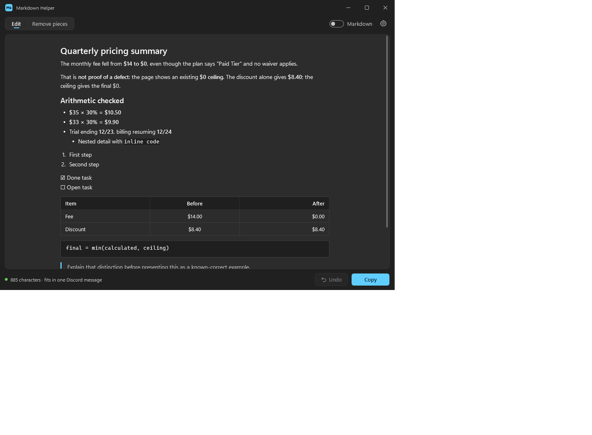
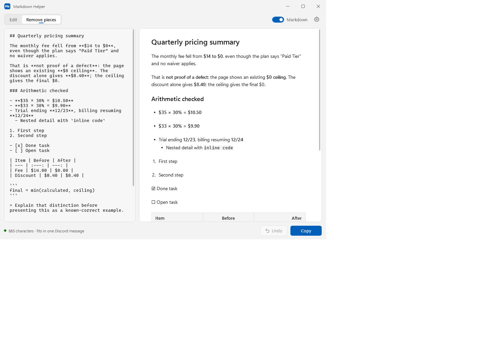

# Markdown Helper

Copy markdown from an AI tool. Paste it into Teams or Discord looking right.

Markdown Helper is a small Windows tray tool. It notices markdown on your
clipboard, lets you check and trim it, and puts a version on the clipboard that
pastes correctly in both places with a single copy.



## Why

Chat apps paste AI output as raw text, full of `**` and `##`. Pasting through an
editor's markdown preview helps, but those often treat dollar signs as math, so
text like "from **$14 to $0**" comes out as garbled equations. Here a dollar
sign is always a dollar sign.

## How it works

One copy puts two versions on the clipboard, and each app takes the one it
understands:

| Paste into | What it gets |
| --- | --- |
| Teams, Outlook, Word | Rich formatting, including tables |
| Discord | Plain text that Discord displays as markdown, with tables turned into aligned text |

## Install

1. Download `MarkdownHelper.exe` from the [latest release](https://github.com/csharpengineer/markdown-helper/releases/latest).
2. Run it. There is nothing to install.

It needs Windows 10 (version 1903 or later) or Windows 11, which already include
everything it uses. The file is not code signed yet, so Windows SmartScreen may
warn you the first time. Choose **More info**, then **Run anyway**.

## Using it

Copy some markdown. A small popup appears in the corner, and fades away if you
ignore it. It never takes focus from what you're doing.

- **Copy formatted** converts it straight away, ready to paste.
- **Preview** opens the window so you can check it first.

Press **Ctrl+Alt+M** at any time to open the preview with whatever is on the
clipboard.

In the preview:

- **Edit** lets you change the formatted text like a document.
- **Remove pieces** drops a heading, paragraph, list item or table with one click.
- **Markdown** shows the source beside the result. Edits on either side appear on the other.
- The status line shows the length and warns when you're over Discord's 2,000 character limit.



## Settings

Right-click the tray icon and choose **Settings**.

| Setting | Choices |
| --- | --- |
| When markdown is copied | Small popup, tray icon dot only, open the preview, or shortcut only |
| Shortcut | Any key combination with Ctrl, Alt, Shift or Win |
| Popup stays for | 2 to 30 seconds |
| Ignore copies from | Click **+ Add** and pick from the apps that are open. VS Code and terminals are on the list by default |
| Start with Windows | On by default |

If you use Copilot Chat inside VS Code, remove VS Code from the ignore list to
get the popup there. The shortcut works either way.

## Privacy

Everything happens on your PC. The tool makes no network connections and never
writes clipboard text to disk. It skips anything a password manager marks as
private. Settings are stored in `%APPDATA%\MarkdownHelper\settings.json`.

## Building

You need the [.NET SDK](https://dotnet.microsoft.com/download) on Windows. The app
targets .NET Framework 4.8 and has no runtime dependencies.

```bash
dotnet build
dotnet test
```

Tests that touch the real clipboard are skipped unless `MDH_CLIPBOARD_TESTS=1` is
set, so they leave your clipboard alone. CI runs them.

`MarkdownHelper.exe --quit` stops a running copy. For development runs,
`--no-startup` leaves the Windows startup entry alone,
`MDH_SETTINGS_DIR` moves the settings folder, and `MDH_THEME=light` or `dark` forces
a theme.

## License

[MIT](LICENSE)
